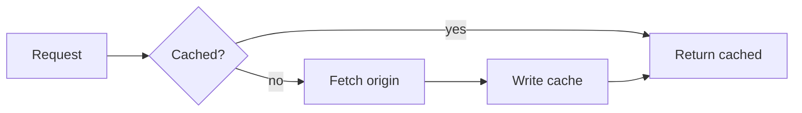
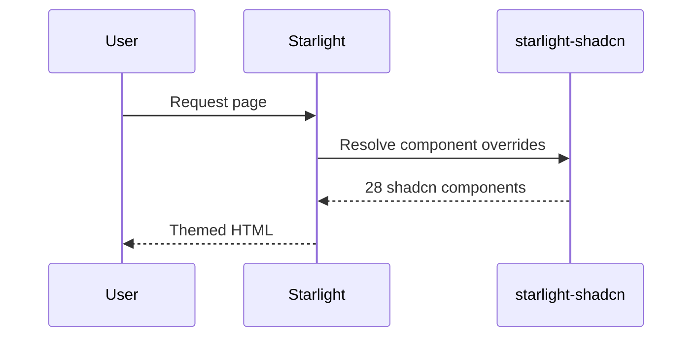

Fence a code block with `mermaid` and the theme renders it as a diagram, using your shadcn tokens for every colour. Toggle light/dark and the diagram re-renders to match.

## Flowchart

## Sequence

## How it works

Expressive Code renders the fence as a code block. On the page, the theme reads each `mermaid` block, renders it with `mermaid.initialize({ theme: 'base', themeVariables })` using `--primary`, `--muted`, `--border` and `--foreground`, and swaps the diagram in. Toggling light or dark renders it again.

`mermaid` is an **optional** peer dependency. Leave it uninstalled and the source stays visible as a plain code block.
